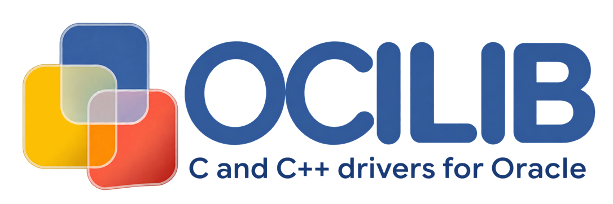

[](https://ocilib.net/doc/html/)
[](https://github.com/vrogier/ocilib/releases)
[](https://github.com/vrogier/ocilib/blob/main/LICENSE)

<picture>
  
</picture>

## 1. About

OCILIB is an open-source, cross-platform library offering the most complete and advanced Oracle
database drivers for C and C++. Built on Oracle Call Interface (OCI), it combines broad feature
coverage with fast, reliable database access and a consistent programming experience.

Use its modern C and C++ APIs to build applications ranging from everyday SQL clients to systems
that rely on Oracle's advanced data and availability features.

OCILIB supports MBCS and wide (UTF-16) applications, adapts to the Oracle client available at runtime, and runs across major platforms.

## 2. License

The source code is free source code licensed under **Apache License, Version 2.0** - see [LICENSE file](LICENSE)

## 3. Features

OCILIB covers the capabilities used by almost all Oracle applications, while also supporting
specialized Oracle services and advanced data types such as SODA and the VECTOR data type.

| Feature | Minimum Oracle release |
|---|---|
| Cross-platform C API (ISO C11), with 32-bit and 64-bit support | 8.0 |
| Modern C++ API (C++17), header-only, with iterators usable with standard algorithms | 8.0 |
| MBCS and wide builds, including UTF-8 (MBCS) and UTF-16 (wide) strings | 8.0 |
| Automatic adaptation to the runtime Oracle client version | 8.0 |
| Runtime loading of Oracle client libraries | 8.0 |
| SQL and PL/SQL, including blocks, cursors, index-by tables, and nested tables | 8.0 |
| Connections, sessions, transactions, and connection pooling | 8.0 |
| Statement execution, binding, fetching, bulk operations, and DML returning | 8.0 |
| Oracle types: scalars, dates, timestamps, intervals, LOBs, LONGs, RAWs, ROWIDs, cursors, objects, REFs, and collections | 8.0 |
| Error handling, Oracle warnings, optional logging, and diagnostic statistics | 8.0 |
| SQL and Object APIs, schema description, multiple-client environments, and hash tables | 8.0 |
| Transparent Application Failover (TAF) and high availability | 8.0 |
| Oracle Direct Path loading | 8.0 |
| Scrollable statements and result sets | 9i |
| Advanced Queuing (AQ) | 9i |
| Statement caching | 9.2 |
| Database Change Notification / Continuous Query Notification | 10.2 |
| Remote database startup and shutdown | 10.2 |
| Oracle Sharding, including sharded connections and session pools | 12.2 |
| Oracle SODA (Simple Oracle Document Access; NoSQL API) | 18c |
| Oracle JSON data type support, including DOM and serialized JSON operations | 21c |
| Oracle VECTOR data type support | 23ai |

Feature availability also depends on the Oracle client version used by the application.

## 4. Requirements

- **Oracle versions** — OCILIB is compatible with all Oracle versions from 8.0 and adapts automatically to the Oracle client available at runtime, including future versions
- **C API** — requires a C11 or later compiler
- **C++ API** — requires a C++17 or later compiler
- **Platforms** — Windows, Linux, HP/UX, Solaris, AIX, Mac OS X, OpenVMS

## 5. Examples

#### Minimal OCILIB C application

```C
#include "ocilib.h"
 
int main(int argc, char *argv[])
{
    OCI_Environment* env = OCI_EnvironmentCreate(NULL, NULL, OCI_ENV_DEFAULT);
    OCI_Connection*  cn  = OCI_ConnectionCreate(env, "db", "usr", "pwd", OCI_SESSION_DEFAULT);
    OCI_Statement*   st  = OCI_StatementCreate(cn);
 
    OCI_ExecuteStmt(st, "select intcol, strcol from table");
 
    OCI_Resultset* rs = OCI_GetResultset(st);
 
    while (OCI_FetchNext(rs))
    {
        printf("%i - %s\n", OCI_GetInt(rs, 1), OCI_GetString(rs,2));
    }
 
    OCI_EnvironmentFree(env);
 
    return EXIT_SUCCESS;
}
```

#### Minimal OCILIB C++ application


```C++
#include "ocilib.hpp"
 
int main(void)
{
    try
    {
        ocilib::Environment env;
        ocilib::Connection  con(env, "db", "usr", "pwd");
        ocilib::Statement   st(con);

        st.Execute("select intcol, strcol from table");
 
        ocilib::Resultset rs = st.GetResultset();
        for (auto&& row : rs)
        {
            std::cout << row.Get<int>(1) << " - " << row.Get<ocilib::ostring>(2) << std::endl;
        }
    }
    catch(ocilib::Exception &ex)
    {
         std::cout << ex.what() << std::endl;
    }
 
    return EXIT_SUCCESS;
}
```

## 6. Installation

You can either use OCILIB release packages or reference OCILIB packages from your favourite package manager if latest version is available.

### Windows platforms

The easiest way is to install the `ocilib` NuGet package (available on nuget.org and GitHub Packages) directly into your Visual Studio project — it brings the headers, libraries and DLLs automatically.

Alternatively, using the zip release archive:

- unzip the archive
- copy ocilib\include\ocilib.h to any place located in your include’s path
- copy ocilib\lib32|64\ocilib[x].lib to any place located in your libraries path
- copy ocilib\lib32|64\ocilib[x].dll to any place located in your windows path

### GNU (Unix / Linux) platforms

- untar the archive
- $ cd ocilib-x.y.z
- $ ./configure
- $ make
- $ make install (you might need to `su` to make install)

Make sure Oracle and OCILIB libraries paths are defined in your shared library environment variable.

#### OCILIB specific configure options

| Option | Values | Default | Description |
|---|---|---|---|
| `--with-oracle-import` | `linkage`, `runtime` | `linkage` | `linkage` links directly against `libclntsh`; `runtime` loads the OCI library dynamically at runtime |
| `--with-oracle-charset` | `mbcs`, `wide`/`unicode` | `mbcs` | MBCS vs wide (`OCI_CHARSET_MBCS`/`OCI_CHARSET_WIDE`) build |
| `--with-oracle-home` | path | - | Oracle installation root (sets headers and library paths) |
| `--with-oracle-headers-path` | path | - | Location of OCI public headers (instant client `sdk/include`) |
| `--with-oracle-lib-path` | path | - | Location of the OCI shared library (instant client lib dir) |
| `--with-custom-loader` | flag | - | Custom runtime loader flag |
| `--enable-warnings` | `no`, `yes`, `paranoid` | `yes` | Compiler diagnostics level |
| `--enable-werror` | flag | `no` | Treat compiler warnings as errors (CI only) |
| `--enable-sanitizers` | `=LIST` | `no` | Build with sanitizers (default LIST: `address,undefined`) |

Example using an Oracle Instant Client:

- $ ./configure --with-oracle-headers-path=/opt/oracle/instantclient_23_26/sdk/include \
                --with-oracle-lib-path=/opt/oracle/instantclient_23_26

## 7. Building from source

### Windows

Visual Studio projects are provided under `proj/`:

- `proj/dll` — OCILIB library (DLL) project
- `proj/test` — unit test project (`tests/ocilib_tests.vcxproj`)
- demo projects under `proj/` for each `demo/*.c` / `demo/*.cpp` sample

Open the project or solution matching your Visual Studio version and build the desired configuration (`Release - MBCS` / `Release - WIDE`).

### GNU (Unix / Linux)

- $ ./reconf          (regenerates the autotools build files, needed after cloning)
- $ ./configure       (see OCILIB specific configure options above)
- $ make
- $ make install

## 8. Testing

The unit test suite (`tests/`, gtest-based, 2,100+ tests covering the C and C++ APIs) requires a reachable Oracle database; connection parameters are hardcoded in `tests/ocilib_tests.h` (`DBS`, `USR`, `PWD`, `SYS_USR`, `SYS_PWD`) — adjust them to your environment before building. The suite builds from `tests/ocilib_tests.sln` (MSVC) and runs as `ocilib_tests`.

The standalone demos in `demo/` take their connection parameters from environment variables instead:

- `OCILIB_DEMO_DB` — connection string (e.g. `localhost:1521/FREEPDB1`)
- `OCILIB_DEMO_USR` — user name
- `OCILIB_DEMO_PWD` — password

## 9. Documentation

The complete OCILIB API reference is available online at https://ocilib.net/doc/html/.

A step-by-step tutorial series ships with the sources under `doc/tutorials/` — ~90 lessons covering the whole C and C++ API, from first connection to JSON, SODA and sharding, with every code sample in both languages. Open `doc/tutorials/html/index.html` to read it offline.

Migration guides for moving from OCILIB 4.x to 5.0 live in `doc/` — written so they can be fed to an agentic coding tool (precise find → replace rules with exact signatures):

- `doc/migration-guide-c-api.md` — migrating the C API
- `doc/migration-guide-cpp-api.md` — migrating the C++ API

## 10. Support

- Website: http://www.ocilib.net
- Issues: https://github.com/vrogier/ocilib/issues
- Changelog: [CHANGELOG.md](CHANGELOG.md)

## 11. AI-assisted development disclosure

Starting with OCILIB v5, AI-assisted development tools, including agentic AI, are used to support the
following activities:

- **Unit testing** — generation of unit tests for existing APIs
- **Code analysis** — assistance in identifying potential bugs, flaws and areas for improvement in existing code
- **Automated refactoring** — assistance with large-scale, repetitive refactoring across multiple source files, significantly reducing the time required for these changes while maintaining consistency throughout the codebase
- **Feature Analysis** — preliminary analysis and implementation draft proposals, subsequently subject to extensive design review, debugging, modification and integration to ensure consistency with OCILIB's architecture, coding conventions and design principles

All resulting changes are reviewed and validated by the maintainer, who retains full responsibility for
the implementation, code quality and ongoing maintenance.
